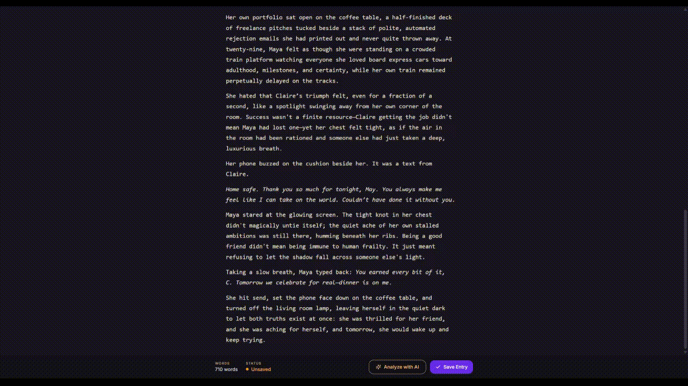
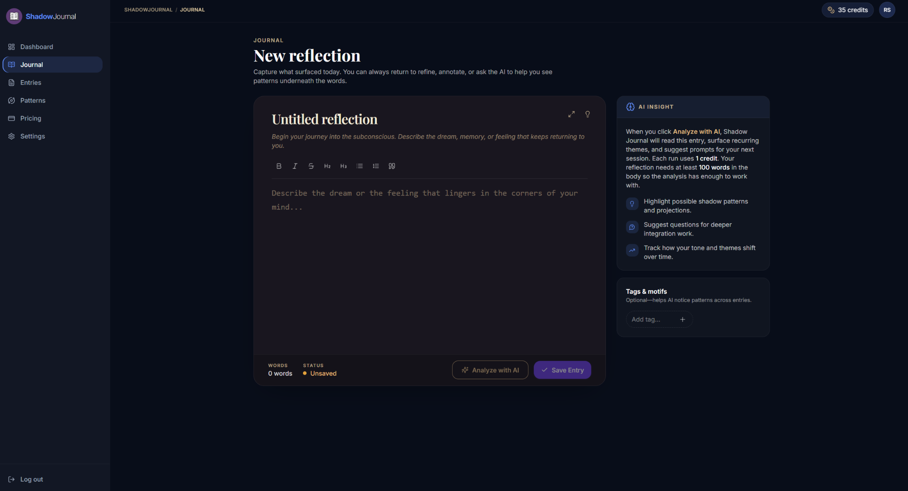
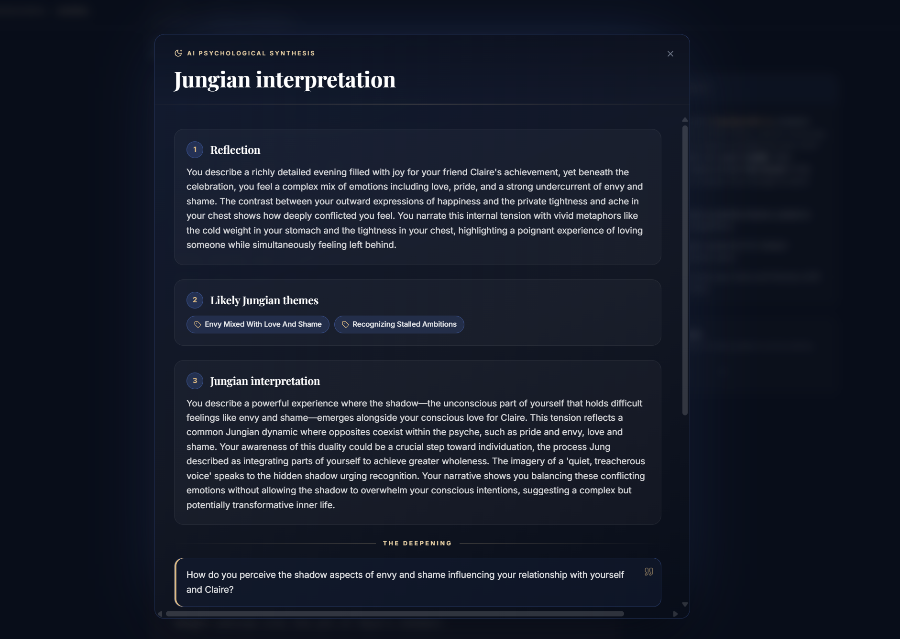
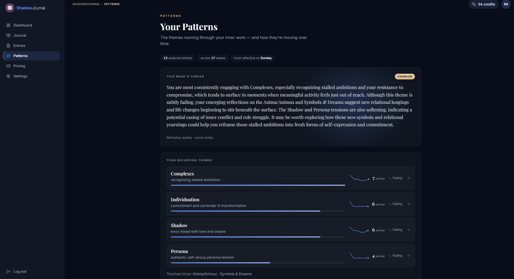
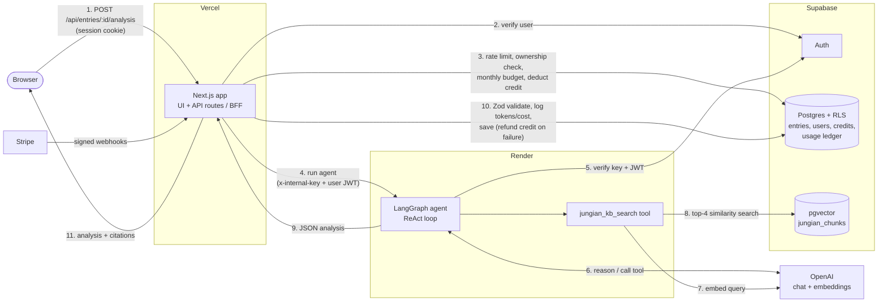

# Shadow Journal

A journaling app that analyses entries through Jungian psychology, using retrieval-augmented generation over Jung's own texts instead of the model's memory.

**Live:** [PLACEHOLDER: live URL]

| Journal editor | AI analysis with citations | Patterns dashboard |
| --- | --- | --- |
|  |  |  |

> The source code is private. This repository documents the architecture and design decisions. Selected excerpts are in [docs/snippets.md](docs/snippets.md).

---

## What it does

You write journal entries in a rich-text editor and track your mood over time. When you click **Analyse with AI**, the app returns a structured reflection: what the entry expresses, 1–4 Jungian themes, a hedged interpretation, 2–3 open questions, and one short exercise. Each analysis lists the passages from Jung's *Collected Works* it drew on. Over several entries, a Patterns page shows which themes recur and how they change over time.

Analyses cost credits. Credits come from a Stripe subscription or one-time purchases.

---

## Architecture

pnpm monorepo with two deployable apps:

- **`apps/web`**: Next.js (App Router) on Vercel. It serves the UI and acts as the backend-for-frontend (BFF): auth, credits, rate limits, billing, persistence.
- **`apps/agents`**: LangGraph agent on Render. It is an internal AI service that handles retrieval and LLM calls only. It is never called from the browser.

### "Analyse with AI", step by step

1. **Web (BFF)**: resolve the user from the session. Apply rate limits per user (12/min) and per IP (30/min). Load the entry filtered by both `id` and `user_id`. Check the user's monthly token and cost budget, then deduct one credit.
2. **Agent**: reject the request unless it carries the internal service key and a valid Supabase JWT. Run the ReAct loop: the model calls the knowledge-base tool, which embeds a query and fetches the 4 nearest chunks from pgvector, and then the model writes the JSON analysis.
3. **Web (BFF)**: parse and validate the JSON with Zod. Record token usage and estimated cost in a ledger table, then save the analysis on the entry. If any step fails (agent error, invalid JSON, schema mismatch), the deducted credit is refunded.

### Why two services

- LangGraph runs its own long-lived HTTP server, which needs a host that stays up.
- An agent run (several LLM calls plus retrieval) can outlast serverless function time limits.
- Business rules (who may run an analysis and what it costs) stay in one place, the BFF. The agent only does AI work.

The cost is an extra network hop, a second deploy that must stay in sync with the web app's output schema, service-to-service auth, and cold starts on a low-cost hosting tier.

---

## The RAG pipeline

The knowledge base is two volumes of Jung's *Collected Works* (Vol. 7 and Vol. 9i), ingested as PDFs.

**Ingest (offline, run manually):**

| Step | Implementation |
| --- | --- |
| Load | LangChain PDF/text loaders; each file is hashed with SHA-256 |
| Skip unchanged | if a file's hash matches what's stored, it is not re-embedded |
| Chunk | `RecursiveCharacterTextSplitter`, **chunkSize 700 characters** (~175 tokens), **overlap 120** |
| Embed | OpenAI **`text-embedding-3-small`** (1,536 dimensions) |
| Store | one row per chunk in a Postgres table with a pgvector column: text, embedding, source, chunk index |

**Query (each analysis):**

| Step | Implementation |
| --- | --- |
| Query | the model writes the search query itself from the entry's central theme, not the raw entry text |
| Embed | same embedding model |
| Search | a Postgres RPC function runs a pgvector similarity search, **top-k = 4** by default (the tool allows 1–8) |
| Confidence | the highest similarity among the results, passed back to the model; the prompt tells it to hedge below **0.45** |
| Generate | the model writes the analysis using the retrieved passages and cites the ones it used |
| Validate | the BFF validates the output with a **Zod schema** (field types, 1–4 themes, 2–3 questions, citations array) |

Citations (source, chunk id, preview) are stored with the analysis and shown in the UI.

---

## The agent

The agent is a LangGraph **ReAct loop** with two nodes: `callModel` and `tools`. After each model turn, a router checks for tool calls. If there are any, it runs the tools and loops back to the model. Otherwise the run ends.

- **Tools**: `jungian_kb_search` (the RAG retriever above). An optional web-search tool is added only if its API key is configured.
- **Analysis mode**: a system prompt block requires at least one knowledge-base search before answering, hedged wording ("this may point to…"), no diagnosis, a gentler tone and a referral suggestion when an entry shows distress, and JSON-only output.
- **Server-fixed configuration**: the model name and system prompt are set on the server. Callers can only switch `analysisMode` on or off. Otherwise any authenticated caller could run arbitrary prompts or models on the project's API keys.

**Why a ReAct agent instead of one fixed retrieve-then-generate call:** the model reads the entry first and then writes a search query in the corpus's vocabulary (for example "projection onto authority" instead of "I can't stand my boss"). That gives better retrieval than embedding the raw entry. The trade-off is one extra LLM round-trip per analysis and less deterministic control flow.

---

## Production hardening

| Concern | What's in place |
| --- | --- |
| **Row Level Security** | RLS is enabled on user tables. Policies restrict rows to `auth.uid() = user_id`, so the public anon key alone can't read other users' data. |
| **Client trust levels** | Three Supabase clients: browser (anon key, RLS applies), per-request server client (user's cookies, RLS applies), and an admin client (service-role key, bypasses RLS). The admin client is server-only and used for trusted writes such as credits, the ledger and webhooks. |
| **Web → agent auth** | Every agent request needs a shared internal key, compared in constant time, **and** a Supabase JWT verified by the agent. If the key isn't configured, the agent rejects all requests. Without the key, a user with a valid JWT could call the agent directly and skip credits and rate limits. |
| **Content Security Policy** | Strict CSP with an allow-list of origins (Supabase, Stripe, Cloudflare Turnstile, analytics), `frame-ancestors 'none'`, `object-src 'none'`, and `nosniff` / `X-Frame-Options` / `Referrer-Policy` / `Permissions-Policy` headers. |
| **Bot protection** | Cloudflare Turnstile on sign-up, sign-in and password reset. Tokens are verified on the server against Cloudflare's siteverify API. |
| **Idempotent Stripe webhooks** | Signature-verified. Subscription credit refills claim the invoice id in a table with a primary key first, so a retried webhook hits a unique-constraint violation and is skipped. Credits are never granted twice. |
| **Compare-and-swap credits** | Deduction is an `UPDATE … WHERE balance = <value just read>` with up to 4 retries, so two concurrent analyses can't both spend the same credit. Refunds use the same pattern. |
| **Token / cost ledger** | Every LLM run writes input/output tokens, model and estimated USD cost to `llm_usage_events`. Before each analysis, a per-user monthly token cap and cost cap are checked against this ledger. |
| **Prompt-injection surface** | Model name and system prompt can't be changed by callers (see above). Output passes schema validation before it is stored. |

---

## Tech stack

- **Frontend / BFF**: Next.js 15 (App Router), React 19, TypeScript, Tailwind CSS 4, TanStack Query, TipTap editor
- **AI**: LangGraph.js, LangChain.js, OpenAI (`gpt-4.1-mini` default, `text-embedding-3-small`)
- **Data / auth**: Supabase (Postgres, pgvector, Auth, RLS)
- **Payments**: Stripe (subscriptions, one-time purchases, customer portal, webhooks)
- **Validation**: Zod (API input, model output, forms)
- **Security**: Cloudflare Turnstile, CSP headers
- **Hosting**: Vercel (web), Render (agent)
- **Tooling**: pnpm workspaces, Vitest, ESLint, Prettier, GitHub Actions CI (format, lint, spelling, tests, build, dev-server startup)

---

## Trade-offs and known gaps

| Gap | Current state | What I'd do next |
| --- | --- | --- |
| **No evals** | Tests cover deterministic code. Nothing measures retrieval quality or answer groundedness. | Build a golden set of ~20 entries, measure top-4 retrieval hit rate, and use an LLM-as-judge for groundedness and hedging. Run it on every prompt or model change. |
| **In-memory rate limiting** | Counters live in each server instance's memory, which serverless instances don't share. | Move the limiter to a shared store (Redis/Upstash or a Postgres table). |
| **Minimal observability** | `console` logs plus the token/cost ledger. No tracing or alerting. | Add LangSmith (or OpenTelemetry) traces for agent runs and alerts on error rate and spend. |
| **Thin tests** | ~40 unit tests (prompt building, pattern aggregation, rate limiter, Stripe config). No integration tests for API routes or webhooks. | Add route-level tests for the analysis flow (including the refund path) and webhook replay tests. |
| **Weak-match handling** | Top-k always returns 4 chunks, even for unrelated entries. The low-confidence UI flag is based on citation count, not similarity score. | Add a similarity threshold, base the UI flag on the score, and tune both with evals. |
| **Agent runtime mode** | The agent runs the LangGraph server in its dev mode on a Node web service (no custom container), with non-persistent thread storage. This works because analyses are one-shot and results are saved in Supabase. | Switch to a production LangGraph deployment with a persistent store. |
| **Index pruning** | Ingest skips unchanged files but doesn't remove chunks of deleted sources. | Delete chunks whose source no longer exists at ingest time. |

---

## Code access

The code is available on request.